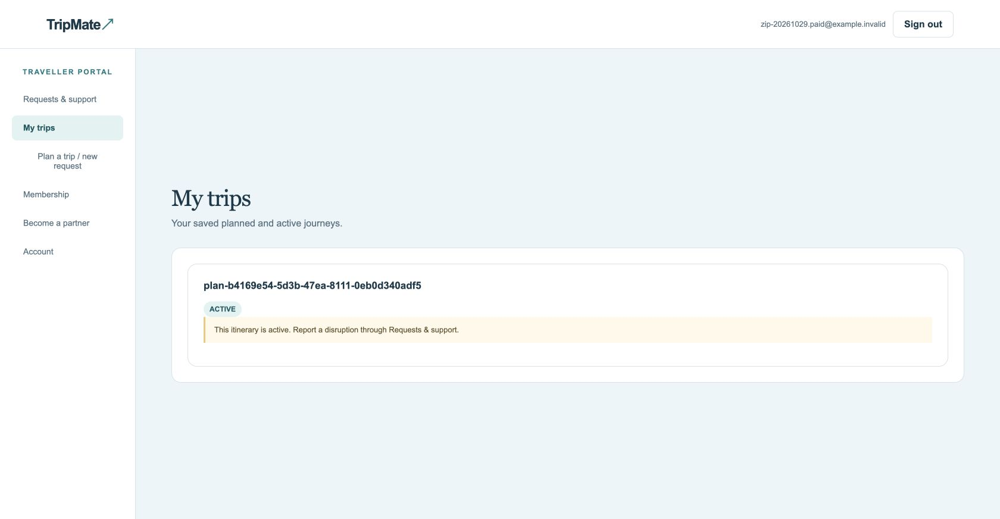
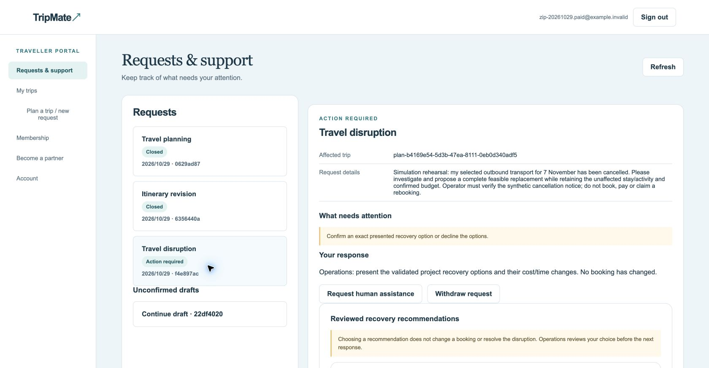
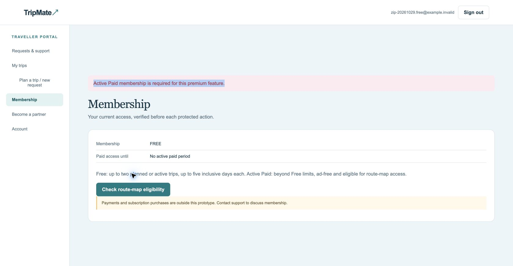
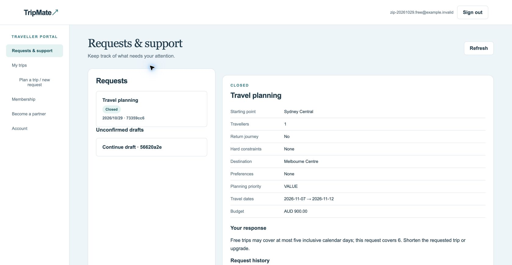

# TripMate Demo 与人工验收路径

2026-10-29 实测记录。默认启动端口8780；本轮验收服务使用8784。下面按钮为英文页面文字。截图来自真实页面，未展示密码。示例旅行日期2026-11-07至09适用于11月5日Demo；日期过后应新建独立场景，不能修改旧证据冒充有效。

## 先启动和登录

1. 解压后进入包含README、pyproject.toml、scripts的根目录，运行 `python3 scripts/setup_demo.py`。
2. 在根目录配置一个 `.env`，使用小组提供的Supabase和课程模型配置；连接校园网/VPN。不要把密钥写进网页或提交ZIP。
3. 使用已准备的云项目，不重放初始化建表。新项目需管理员按顺序应用缺失迁移，包括按需读取迁移；新建项目从零部署尚未实际验收。
4. 运行 `.venv/bin/python scripts/start_demo.py`，看到云端、模型预检通过和服务地址后打开该地址，保留终端窗口。
5. 专用账户的密码在本地manifest `.demo-accounts.local.json` 的accounts中；按free/paid/supplier/operator选择email与password。账号不是GitHub账号，普通注册不会创建Operator或Supplier。不要把私密账户文件提交Git。
6. 切换角色先Sign out。同一个浏览器的标签共享身份，不能把旧页面当作另一个账户；建议一个活动演示页。输入错误时清空邮箱后重新输入，避免浏览器自动填充和粘贴叠加。

本轮专用账户namespace为zip-20261029，场景rehearsal-one，已准备的四个角色无需重复创建。新电脑若没有密码manifest，应取得小组私密交接文件，或按README准备新namespace，不能覆盖原账户。

## 案例1：Supplier提交报价，Operator审核

目标：展示Supplier对供应信息和定价规则的检查，以及Operations的审核交付。普通报价审核不等于实际采购。

1. Supplier登录 `/supplier`，打开已有Supplier offer，查看结构化报价与评估。演示数据包含普通交通、住宿、活动，以及过期、零库存、受限报价。
2. 新建报价使用页面供应商请求表单，填写产品类别、服务地点/起止时间、报价有效期、可用数量、供应商成本、全部强制费用及条款，Review request后核对并明确确认，再Start processing。
3. 使用有效日期且价格信息齐全的普通报价。演示配置为加价10%、最低差价AUD15；供应成本AUD50只产生AUD5差价，应失败。可用AUD200示例检查AUD20差价，不能为了通过而降低规则。
4. Sign out，Operator登录 `/admin`，在Work queue按案件ID前8位找到同案。查看报价评估，填写理由并Record offer review；普通合格报价应为APPROVED。
5. 若要把正式响应交给Supplier，仍需Operations的Record a reviewed decision，然后Send checked response。报价合格与外发响应是不同步骤。

管理员记录：同案详情的报价评估、Request history显示输入、验证、版本和决定。页面没有独立“归档中心”或全量服务器日志导出。

实测：四个普通种子报价经Operator审核；手工AUD50活动报价正确MARGIN_FAILED。过期/零库存/受限场景已准备，部分边界由自动化覆盖，不能宣称所有负例已逐个鼠标验收。受限报价进入Planning的完整流程仍不支持完整演示。

## 案例2：Paid旅客规划、比较和采用

前提：普通报价已审核；Sydney Central到Melbourne Centre，1人，11月7日至9日，总预算AUD900，无返程，Value优先。此场景的可用资源在专用供应数据中。

1. Paid Traveller登录 `/app` → Plan a trip / new request，选择Plan a trip，填写起终点、日期、人数、预算和必填说明。
2. Review request，核对完整摘要并明确确认；在案件详情点击Start processing。处理时等待，不连续点击。
3. 生成后应先是Under review，旅客不能提前采用。真实课程模型用于需求提取/受约束规划，随后由业务校验检查资源、时间和成本。
4. Operator登录Work queue，按案件ID找到同案，检查方案相关记录与Request history，填写Evidence and reason，Record decision，状态允许后Send checked response。
5. 旅客重新登录打开同案，查看已交付方案和比较结果；勾选I explicitly choose this exact itinerary version，再Adopt this option。
6. My trips应显示PLANNED。采用只记录选择，没有订票或付款。

管理员记录：规划案件ID、方案版本ID、Request history中的交接/模型处理/约束校验/审核/交付。完整内部快照及精确开始时间不是当前页面全部可见内容，只能后端或自动化补充核验。

实测：案件0629ad87曾实际生成并交付AUD594方案、采用成功。候选可能出现相同可见安排但来源身份不同的问题，WN5620-61尚待排查；不要将相同展示的选项宣称不同旅行路线。

## 案例3：修订预算、开始行程、重启读取

1. 在已采用版本基础上创建Revise an itinerary请求，使用原版本ID，预算改AUD800，其他条件保持不变。预算是上限，原AUD594仍合格，因此不要求价格自动降低。
2. 经处理、Operator审核及交付后，比较并明确采用新版本；旧版本保留。
3. My trips内勾选明确开始行程的确认框，再Start this trip。Paid权限应重新检查，状态变ACTIVE。
4. 若行程已经Active，再采用修订版本，应保留Active和原开始时间，不要求重新开始。
5. 停止服务终端（Ctrl+C），用相同目录、同一.env重新运行启动脚本；重新登录，检查My trips、原案件及Request history。

实测：案件6356440a修订后采用5313…版本；原行程plan-b416…保持Active。原开始时间保持曾由后端只读检查确认，页面不显示该精确时间，不能仅靠截图证明。服务重启后原行程和三个案件可重新读取。

## 案例4：Active行程取消恢复、旅客选择及再次审核

前提：Paid Active行程，已有完整有效普通供应资源。不要把旅客一句“航班取消”当成已核实证据；本轮交通资源是模拟交通服务，不声称真实航空公司通知。

1. Traveller → Plan a trip / new request → Travel disruption，填写Affected trip和模拟取消说明，确认后记下案件ID。
2. Operator打开同案，在Investigation evidence选择确切取消交通项，填写Cancellation notice reference（例如 `synthetic://demo/cancellation-1`）、未来有效期、AUD0沉没成本、SUFFICIENT，确认属于提供的模拟证据，Record cancellation evidence。普通恢复场景先不勾风险/受限标记。
3. Traveller同案Start processing。Exception负责调查协调，Supplier寻找合格替代资源，Planning校验完整候选；不能把这些确定性适配器都说成独立LLM调用。
4. Operator查看Investigation evidence概要与Request history，Record decision审核响应，然后Send checked response。
5. Traveller打开Reviewed recovery recommendations，比较总成本、到达时间变化、安排和条款，选择一个，勾选I confirm this exact recovery recommendation，Choose this recommendation。
6. 此时应回到Under review。Operator再次审核并交付选择确认。案件保持开放/Action required，不得写成已完成改签或旅行恢复。

管理员记录：同一个取消案件ID、证据引用、所选恢复版本、Request history中调查交接、校验、提案和响应批准。原始内部调查快照不全部显示在旅客页面，Supplier内部成本不应外泄。

实测：f4e897ac完成上述主链路；曾选择AUD594、到达变化300分钟的替代建议，再审核交付。重启后恢复建议及批准/交付时间线仍能读取。

## 案例5：证据变更、受限提案与外发响应分别批准

1. 使用案例4同案。Operator在允许的Action required阶段更新模拟证据引用，明确勾选A restricted commitment is requested；确认模拟事实并Record cancellation evidence。
2. Traveller应看到证据变化须重新确认，旧可选建议被撤回。填写Additional details，勾选I confirm the updated request details，Confirm additional details，再Start processing。
3. 处理后应为Waiting for human approval，旅客不能获得新响应或可选恢复建议。
4. Operator先仅批准保存的提案：填写理由、Decision选Approve、Record decision；不要在这一步编辑外发响应。结果应为Under review，不能发送。
5. 单独检查外发响应，再Record decision。达到Checked response ready后才Send checked response。
6. 旅客可选择或勾选拒绝确认框后Decline recommendations。拒绝应转人工且保留原行程；本轮未实际点击拒绝，只有自动化覆盖。

实测：同案新版证据-2使旧选择失效；提案批准18:23:15、响应批准18:25:41、交付18:28:05分别记录。时间为本轮示例，不是新演练预期时间。

## 非功能验证及剩余边界

| 项目 | 如何查看 | 本轮结论/限制 |
|---|---|---|
| 角色隔离 | Free登录后访问/admin | 实际ACCESS_DENIED；跨具体案件ID的403主要由自动化覆盖 |
| 旅客隐私 | 案例2/4查看已交付响应 | 实际查看公开方案；不应显示供应商成本或未批准内部草稿 |
| Free地图限制 | Membership → Check route-map eligibility | 实际显示Active Paid required |
| Free行程天数 | Free提交11月7日至12日六天行程并处理 | 案件73359cc6实际提示最多五个自然日，不生成可采用方案 |
| Free两个行程上限 | 尝试在已有两个Planned/Active行程时再采用 | 尚未UI实测；自动化覆盖，不要批量创建伪采用记录冒充 |
| 版本和旧批准失效 | 案例3/5 | 已实际验证新修订、旧选择撤回；完整不可变快照由自动化补充 |
| 提案/响应审批分离 | 案例5 | 实际两次独立决定，第一次后不能发送 |
| 重复操作与幂等 | 同案重复点击不可重复采用/批准 | 自动化覆盖；本轮未故意重复批准云端数据 |
| 持久化 | 案例3重启后查看案例4 | 实际行程ACTIVE、案件、恢复建议和审批轨迹可读取 |
| 无可行方案、保存失败 | 合法专用场景缺少合格替代资源/隔离故障注入 | 自动化覆盖；尚未全量UI实测，不破坏共享云服务来制造故障 |
| 云端失败不显示成功 | 历史57014及部分保存后刷新失败 | 页面曾明确报错；修复改为按需读取，未来仍可能有网络失败。先重开同案核对历史 |
| 配置与秘密 | 启动终端预检，浏览器只输入登录账户 | 真实云/模型预检通过；不把.env、密码、原始模型推理上传Git |

## 推荐Tutor演示顺序

已审核供应资源 → Paid新规划并审核交付 → 旅客明确采用 → My trips开始行程 → 模拟取消/证据/恢复建议 → 旅客选择及再次审核 → 打开Request history → Free地图/六天拒绝 → 重启后重新读取。时间紧时先演示规划、采用和一条受控恢复路径，审批分离作为扩展。

当前不支持真实订票、支付、退款、改签、合同或广告发布。投诉政策、营销、完整地图、完整会员权益及所有恢复生命周期并非全部完成。上述路径没有证明最终未修改的Canvas ZIP在另一台电脑全部通过；发布后还需最终提交包复验。Windows步骤是操作指引，本轮实际初始化发生在macOS。
