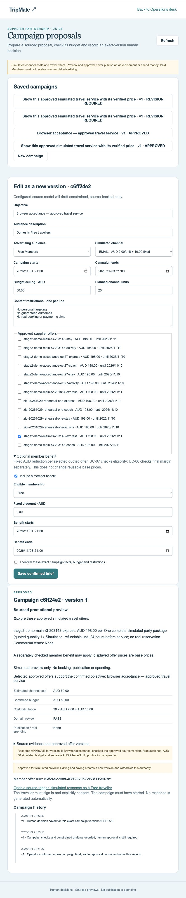
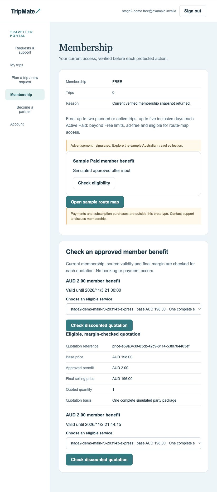
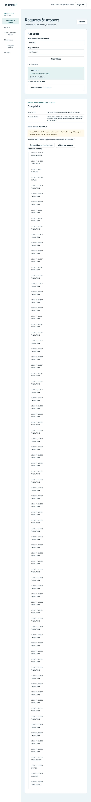
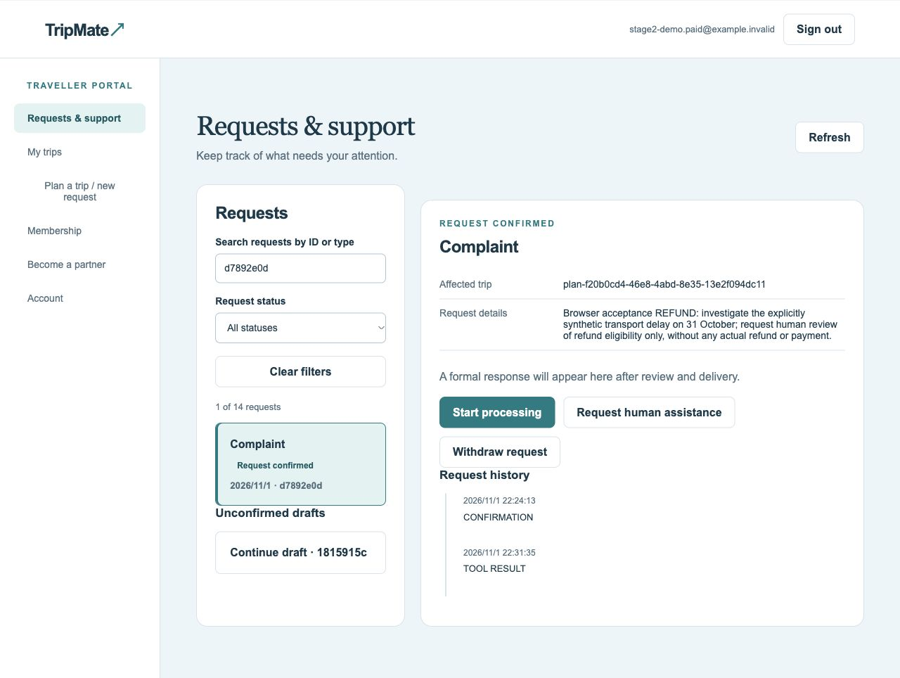

# 2026-11-01 真实云端浏览器验收收尾

日期及时区：2026-11-01，Australia/Sydney。受测代码：main `edab5e02d36b6e40a34d47a5a812ca27e80b928e`（PR #45 合并后）。这是用户下载的新 ZIP，已核对 278/278 个受版本控制文件与该基线一致；不是本次文档提交之后代码的重新验收。

**结论：营销正常闭环通过；投诉的证据校验、证据不足与部分转人工分支通过。正常延误、退款人工审批及其余异常分支未完成。用户最后要求停止测试并整理文档，停止不是验收通过。**

## 环境与证据边界

- macOS，本地门户 `http://127.0.0.1:8791`，后端连接真实 Supabase；通过实际浏览器页面登录、填写、确认和切换角色。
- 运行最新 ZIP 的应用代码，启用模拟定价及课程模型规划；配置和密码来自本机忽略文件，未提交。
- 营销活动草拟使用真实课程模型。投诉流程的规则、调查和转接使用应用的确定性业务适配器；不能把它们称为每一步均调用模型。
- 行程、供应库存、延误和政策均为明确模拟业务输入。没有真实订票、支付、退款、改签或广告发布。
- 原有行程的交通日期为 11 月 7 日，不适合作为已经发生延误的正例。历史模拟行程另行在准备环境构造，固定准备时间后添加到云端；浏览器验收服务时钟没有调整。此前置准备不计为浏览器测试通过。
- [结构化记录](2026-11-01-browser-evidence.json)保存案例定位与截图校验值；不发布原始认证请求、完整云快照或私密日志。

## 第一组：营销活动、审批与会员优惠

| 编号 | 浏览器步骤与预期 | 实际结果 | 判定 / 证据 |
| --- | --- | --- | --- |
| BR-01 | Operator 保存已确认活动需求，草拟评估，检查成本与来源，再明确批准 | EMAIL 20 单位 × AUD2 + AUD10 = AUD50；域检查 PASS；先等待审批，再批准版本 1；规则绑定该版本 | PASS：[批准页面](evidence/2026-11-01/campaign-approved.png) |
| BR-02 | Free 会员在 Membership 选择本轮优惠并查询独立报价 | 基础价 AUD198，优惠 AUD2，最终 AUD196；页面显示 eligible / margin-checked quotation，数量 1 | PASS：[报价页面](evidence/2026-11-01/free-member-quote-196.png) |

浏览器活动 ID：`c6ff24e2-9d8f-4080-920b-6d53f005e078`，规则 `/1`；报价引用 `price-e59a3439-83cb-42c9-8114-53f0704403ef`。它与接口脚本创建的活动是两个案例，不能混用证据。

本轮未在真实浏览器验收：预算不足、受众不符、会员资格不符、不叠加等负例，以及活动来源询问的审批与回复送达。下文接口测试不补足这些浏览器缺口。

## 第二组：投诉、审批和人工处理

| 编号 | 浏览器步骤与预期 | 实际结果 | 判定 / 证据 |
| --- | --- | --- | --- |
| BR-03 | Operator 对未来服务填入未来的“已到达时间”，提交调查证据 | 页面拒绝：`Observed arrival must be a valid past timestamp.`，不能据此建立已发生延误 | PASS：[拒绝提示](evidence/2026-11-01/future-evidence-rejected.png) |
| BR-04 | 没有有效调查证据时，由旅客 Start processing | 进入 Action required，提示 Operator 必须确认投诉证据及适用模拟政策；正式回复不可见 | PASS：[需要补充信息](evidence/2026-11-01/complaint-missing-evidence.png) |
| BR-05 | 旅客申请人工协助，核对状态与记录 | 现有规则在第一次请求时记 HANDOFF；第二次后进入 Human assistance requested，正式回复仍不可见 | PASS：[转人工状态](evidence/2026-11-01/complaint-human-assistance.png) |
| BR-06 | Operator 记录 ITINERARY 类证据，不提供到达时间；旅客启动处理 | 保存成功，调查收集事实后提示该类别缺少约定解决政策，进入 Human assistance requested；未自动发布解决方案 | PASS：[行程类投诉转人工](evidence/2026-11-01/complaint-itinerary-human.png) |
| BR-07 | 在历史模拟行程创建正常 DELAY 投诉并记录 60 分钟延误 | 请求已确认；Operator 已保存 10 月 31 日 12:00 到达及 EXPLAIN_AND_APOLOGISE 政策证据；尚未启动调查、审核或送达 | PARTIAL，无完整闭环通过结论 |
| BR-08 | 在历史模拟行程创建 HUMAN_REVIEW_REFUND 投诉 | 请求已确认；Operator 在 22:31:35 成功保存调查证据，恢复了此前的保存冲突；停止时仍为 Request confirmed，Start processing 可见 | PARTIAL：[停止时状态](evidence/2026-11-01/refund-stopped-before-processing.png)；尚未验证等待人工审批、两阶段批准或送达 |

BR-03/04/05 使用 `04d7c40f`；BR-06 使用 `74a84c4d`。这两条早先请求说明中曾写“historical”，但实际关联的是未来行程，不能把其文字当成已发生延误的证据。BR-06 的有效调查类别为 ITINERARY，转人工结果不证明退款审批。

BR-07 为 `7b8a69d4`，BR-08 为 `d7892e0d`；均关联另行准备的 `plan-f20b0cd4-46e8-4abd-8e35-13e2f094dc11`。交通计划到达时间为 2026-10-31 11:00 +11:00，模拟实际到达为 12:00。停止时没有人工批准或退款执行记录，不能写“退款流程已完成”。

### 第二组仍未完成的浏览器步骤

- BR-07 正常延误调查 → 响应审核 → 送达 → 旅客读取。
- BR-08 退款类调查 → 等待人工审批 → 方案审批 → 独立响应审核 → 送达 → 旅客读取。
- 低置信度证据、其他投诉类别、法律／安全关注标记的各自结果。
- 受限恢复审批、要求修改、拒绝、旅客拒绝建议、运营员接管及最终关闭。
- 新增等待期限、到期检查、提醒和模拟完成控制的真实云端浏览器验收。

这些分支可能已有自动化或旧版本记录；本轮未验收，不据此宣称当前版本通过。没有修改 Jira 或代替组员签收。

## 云端问题与恢复情况

| 观察 | 影响与处理 | 当前结论 |
| --- | --- | --- |
| 登录与部分读取偶发 CLOUD_UNAVAILABLE | 登录曾提示不可用，后续恢复；云端健康及小查询探测曾返回 200 | 不能把单次恢复视为可用性问题彻底解决 |
| 用户提供 22:11:26 的 SQLSTATE 57014 / statement timeout，查询为 tripmate_state() | 与历史数据准备的整体状态读取失败相符；22:11:10 另有认证查询被取消 | 确认有超时／取消；取消原因与超时根因没有完整性能分析 |
| 页面出现 EXCEEDING USAGE LIMITS | 具体超限项目未在本轮核实 | 不能据此直接断言磁盘 I/O 预算耗尽 |
| BR-07 确认后读取草稿列表失败 | 后端记录显示确认已提交，随后 intake 读取超时；刷新发现新案例，未重复确认 | 已保存与后续刷新失败需分别处理 |
| BR-08 调查证据保存出现 409 并发版本冲突 | 页面提示 Another request changed the data；刷新最新版本，核对后重试，最终在 22:31:35 记录成功 | 冲突保护有效，但没有解决全局版本竞争的性能／体验问题 |

测试采用单页顺序操作，但共享云端仍可能有组员其他操作。多人同时测试可能放大查询和写入竞争；没有做受控单人／多人对照，不认定其为唯一原因。既有按需读取优化没有消除业务写入对整体状态的读取。

## 分开记录的接口与隔离测试

### 真实云端接口脚本（不计浏览器通过）

独立活动 `c850016b-5506-4770-b24e-be42d4ce3821` 完成真实课程模型草拟、审批及 198→196 报价。脚本还观察到 Paid 不符合 Free 优惠资格返回 403、额外折扣输入返回 422、预算不足和 Paid 广告受众被拦截；无同意及不符受众的来源请求被拒绝。

Free 同意后创建来源询问 `ba4945bc-ffa1-4f11-94e0-fcd219db03f0`，自动审核后为 READY_TO_RESPOND。脚本错误期待 UNDER_REVIEW，因此整份脚本不能记为全通过；该询问未交付。另一处脚本曾从审批返回值直接读取只在详情接口提供的 usable 字段，随后通过详情接口核对，未重复批准。这两项属于测试脚本假设修正，不是已确认的产品错误。

### 隔离自动化

同一受测 ZIP 的完整后端回归：383/383，278.304 秒，OK。使用隔离依赖，不证明真实云端稳定性或浏览器分支通过。收尾阶段没有再次执行业务测试或改动产品代码。

## 历史记录如何使用

- [2026-10-31 Supplier / UC-08](../stage2/SUPPLIER_ACCEPTANCE_2026-10-31.zh-CN.md)：真实页面、替身认证／云存储／模型，仍保留原边界。
- [云端读取性能对比](../stage2/CLOUD_READ_PERFORMANCE_2026-11-01.zh-CN.md)：另一代码基线的只读接口对比；本轮再出现的写入相关超时不能被其覆盖。
- [五卡隔离验收](../stage2/FIVE_CARD_ACCEPTANCE_2026-11-01.zh-CN.md)：自动化范围与团队签收分开。
- [全部文档](../catalog.md)：历史文件没有删除或改写成最新结论。

## 收尾与后续入口

按用户最终指令停止继续业务操作；保留云端模拟记录和上述状态，不清空、撤回或伪造审批。以后若恢复测试，应先按准确 case ID 重新读取当前状态和证据有效期，再决定下一步；已有记录不可盲目重复提交。当前仍不构成整组发布、最终 ZIP 跨电脑复现或全分支签收。

## 截图预览

### 营销活动批准与会员报价

### 投诉转人工与停止点

